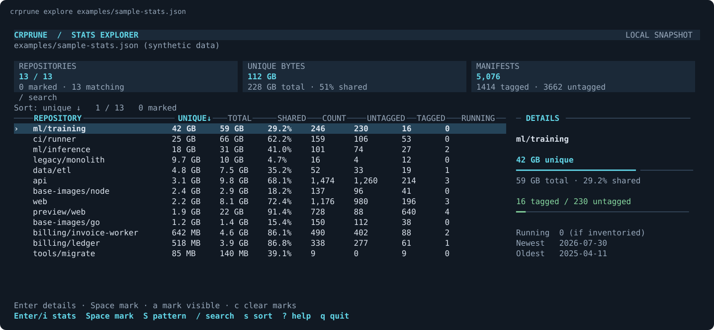

# crprune

**Clean up Azure Container Registry and GitHub Container Registry with rules you can review.**

[](https://github.com/JohanLindvall/crprune/actions/workflows/ci.yml?query=branch%3Amain)
[](https://github.com/JohanLindvall/crprune/releases/latest)
[](LICENSE)

Old pull-request builds, untagged images, and abandoned repositories accumulate.
crprune helps you see what is there, define a JSON retention policy, and preview
what it would remove. It keeps the dependencies and signatures of retained images
together, and **`prune` is a dry run by default**.

[Get started](#quick-start) · [Try the demo](#try-it-without-a-registry) · [Reference](docs/reference.md) · [Contribute](CONTRIBUTING.md)



*Explore repository sizes, search and sort, then inspect the details. This preview
uses synthetic data; you can try it without cloud credentials.*

## Why crprune?

- **One CLI for ACR and GHCR.** Use an Azure registry name or `ghcr.io/<owner>`.
- **Retention rules you can version.** Match repositories, tags, age, newest N
  images, platforms, or digests. Unmatched images are kept.
- **Keep complete images.** Retained multi-arch images keep their platform
  manifests, OCI referrers, and cosign signatures.
- **Protect what you use.** A 24-hour grace period and ACR lock protection apply
  by default. Supply a Kubernetes image inventory to protect running images too.
- **Inspect before deleting.** Use a dry run, a live progress dashboard, or the
  interactive explorer with a deletion preview and typed confirmation.
- **Useful in scripts.** Export JSON statistics, print a size-ranked table, and
  use plain logs in CI.

## Install

Prebuilt releases support **Linux amd64 and arm64**:

```sh
curl -fsSL https://github.com/JohanLindvall/crprune/releases/latest/download/download.sh | sh -s -- ~/.local/bin
export PATH="$HOME/.local/bin:$PATH"
crprune --version
```

The [installer](scripts/download.sh) verifies SHA-256 checksums and replaces an
existing installation only after the new binary runs successfully. You can also
download archives from [Releases](https://github.com/JohanLindvall/crprune/releases).
See the [installation reference](docs/reference.md#install) for pinned versions,
dependencies, and authenticated downloads.

With **Go 1.26 or later**:

```sh
go install github.com/JohanLindvall/crprune/cmd/crprune@latest
```

Ensure Go's binary directory (`$(go env GOPATH)/bin`, or your `GOBIN`) is on `PATH`.

## Try it without a registry

Download the synthetic sample and open the explorer in an interactive terminal:

```sh
curl -fsSL https://raw.githubusercontent.com/JohanLindvall/crprune/main/examples/sample-stats.json -o sample-stats.json
crprune explore sample-stats.json
```

Use **↑/↓** to move, **/** to search, **s** to sort, **Enter** for details,
**?** for help, and **q** to quit. No credentials or registry connection are needed.
For plain output, run `crprune top sample-stats.json -k 5`.
From a source checkout, `make demo` opens the same sample.

## Quick start

**1. Authenticate with your registry.** Choose one:

```sh
# Azure Container Registry: use your existing Azure CLI identity.
az login
REGISTRY=myregistry
```

```sh
# GitHub Container Registry: use your existing GitHub CLI login.
gh auth refresh --scopes read:packages,delete:packages
REGISTRY=ghcr.io/myorg
```

Replace the registry or owner above. GHCR deletion also requires package admin
access. See [authentication](docs/reference.md#authentication) for Azure roles,
managed identity, tokens, and GitHub Actions.

**2. Write a small policy.** This example targets tags starting with `pr-` that
are older than 14 days, across all repositories:

```sh
cat > rules.json <<'JSON'
[
  {
    "description": "Remove pull-request builds older than two weeks",
    "repo": ".+",
    "tagged": [
      { "tag": "^pr-", "match_older": "14d", "keep": false }
    ]
  }
]
JSON
```

**3. Preview and review.** This lists planned deletions without changing the registry:

```sh
crprune -r "$REGISTRY" --progress=plain prune --in rules.json
```

**4. Apply when the preview matches your intent:**

```sh
crprune -r "$REGISTRY" prune --in rules.json --dry-run=false
```

Deleting a manifest removes **all of its tags**. A tag that the policy keeps also
keeps that manifest. Running images are protected only when you supply `--running`.
Follow the [first-cleanup guide](docs/getting-started.md) for a narrower repository
policy, Kubernetes protection, and troubleshooting.

## Commands

| Command | Use it to |
| --- | --- |
| <a id="statistics-alias-stats"></a>[`stats`](docs/reference.md#statistics-alias-stats) | Scan repository sizes and manifest counts into JSON |
| <a id="top"></a>[`top`](docs/reference.md#top) | Print the largest repositories from a saved statistics file |
| <a id="explore"></a>[`explore`](docs/reference.md#explore) | Browse statistics, inspect live images, and review cleanup interactively |
| <a id="prune"></a>[`prune`](docs/reference.md#prune) | Preview or apply a JSON retention policy |
| <a id="generate"></a>[`generate`](docs/reference.md#generate) | Generate a policy keeping only images in a supplied inventory |

```sh
crprune -r myregistry stats --out stats.json
crprune top stats.json -k 10
crprune -r myregistry explore
crprune prune --help
```

`top` and file-based `explore` work offline. `generate` also works offline and uses
`--registry` to select image references. Reported bytes describe referenced blobs,
not guaranteed reclaimed storage.

## Documentation

<!-- Preserve bookmarks to the reference sections moved out of this README. -->
<a id="authentication"></a>
<a id="azure-container-registry"></a>
<a id="github-container-registry"></a>
<a id="abac-registries-and-scoped-permissions"></a>
<a id="global-flags"></a>
<a id="interactive-batch-progress"></a>
<a id="rule-file-format"></a>
<a id="repository-rule-fields"></a>
<a id="tagged-rule-fields"></a>
<a id="untagged-rule-fields"></a>
<a id="rule-evaluation"></a>
<a id="included-rule-examples"></a>
<a id="kubernetes-image-inventory"></a>
<a id="protected-manifests"></a>
<a id="locked-images"></a>
<a id="behaviour-notes"></a>
<a id="azure-container-registry-1"></a>
<a id="github-container-registry-1"></a>

| I want to… | Read |
| --- | --- |
| Run my first cleanup | [Getting started and troubleshooting](docs/getting-started.md) |
| Set up Azure or GitHub credentials | [Authentication](docs/reference.md#authentication) |
| Check a flag, exit code, or keyboard shortcut | [CLI reference](docs/reference.md#global-flags) |
| Write or understand a policy | [Rule format and evaluation](docs/reference.md#rule-file-format) |
| Start from an existing policy | [Six included rule examples](docs/reference.md#included-rule-examples) |
| Protect Kubernetes workloads | [Image inventory](docs/reference.md#kubernetes-image-inventory) |
| Understand deletion protections and limits | [Protected manifests](docs/reference.md#protected-manifests) and [behaviour notes](docs/reference.md#behaviour-notes) |
| Build, test, or change crprune | [Contributor guide and package map](CONTRIBUTING.md) |

<a id="package-layout"></a>
<a id="development-and-validation"></a>

## Contributing and support

Questions, bug reports, documentation fixes, and retention-policy examples are
welcome. [Open an issue](https://github.com/JohanLindvall/crprune/issues/new/choose)
or read [CONTRIBUTING.md](CONTRIBUTING.md) to get a local checkout running. Tests
use in-memory registries and HTTP fixtures; no cloud account is required.

Please follow the [Code of Conduct](CODE_OF_CONDUCT.md). If crprune is useful to
you, [star the repository](https://github.com/JohanLindvall/crprune) to help others
discover it.

## Similar work

[Azure/acr-cli](https://github.com/Azure/acr-cli) provides Azure registry tooling.
crprune focuses on declarative retention policies, dependency-aware cleanup, and
support for both ACR and GHCR.

## Security

Report vulnerabilities privately through [GitHub security advisories](https://github.com/JohanLindvall/crprune/security/advisories/new).
See [SECURITY.md](SECURITY.md) for scope and supported versions.

## License

[MIT](LICENSE). Every Go and shell source file carries an SPDX license identifier.
